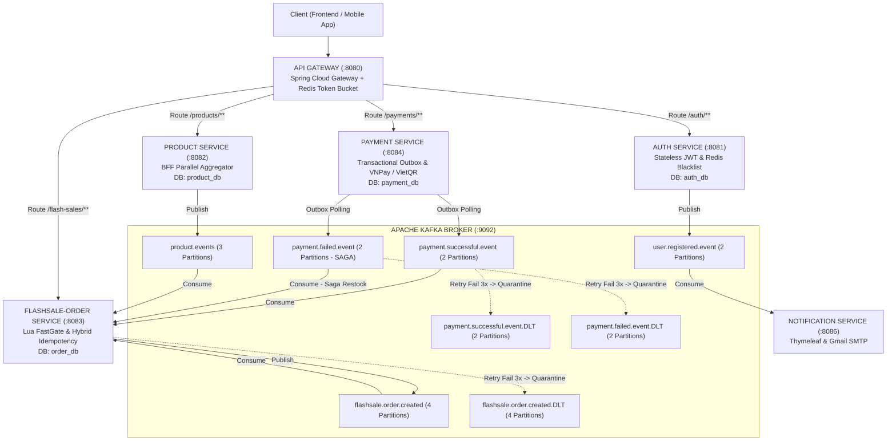

# 🚀 FLASHDEAL API – HỆ THỐNG BACKEND MICROSERVICES & SĂN DEAL PHÂN TÁN

> **High-Concurrency Event-Driven E-Commerce & Flash Sale Backend Engine**  
> *Được xây dựng với: Java 21, Spring Boot 3.4.1, Spring Cloud Gateway, Apache Kafka (KRaft), Redis 7 In-Memory, PostgreSQL 16 (4 Database Độc lập: auth_db, product_db, order_db, payment_db) và Docker.*  

---

## 📑 MỤC LỤC
1. [Tổng Quan Kiến Trúc Backend](#1-tổng-quan-kiến-trúc-backend)
2. [Chi Tiết 6 Microservices & 4 CSDL Độc Lập](#2-chi-tiết-6-microservices--4-csdl-độc-lập)
3. [Bộ 6 Chốt Chặn Chịu Tải & An Toàn Dữ Liệu Doanh Nghiệp](#3-bộ-6-chốt-chặn-chịu-tải--an-toàn-dữ-liệu-doanh-nghiệp)
   - 3.1. [API Gateway Rate Limiting (Redis Token Bucket)](#31-api-gateway-rate-limiting-redis-token-bucket)
   - 3.2. [API Composition Aggregator Đa Luồng (Java Concurrency)](#32-api-composition-aggregator-đa-luồng-java-concurrency)
   - 3.3. [Kafka Dead Letter Topic (DLT) & Fault-Tolerance Retry](#33-kafka-dead-letter-topic-dlt--fault-tolerance-retry)
   - 3.4. [Cơ Chế Lũy Đẳng Chuẩn Doanh Nghiệp (Hybrid Idempotency Pattern)](#34-cơ-chế-lũy-đẳng-chuẩn-doanh-nghiệp-hybrid-idempotency-pattern)
   - 3.5. [Transactional Outbox Pattern (Zero Dual-Write & Chaos Resilience)](#35-transactional-outbox-pattern-zero-dual-write--chaos-resilience)
   - 3.6. [Choreography Saga Pattern (Giao Dịch Bồi Hoàn Phân Tán)](#36-choreography-saga-pattern-giao-dịch-bồi-hoàn-phân-tán)
4. [Bản Đồ Ứng Dụng Redis & Apache Kafka Topics](#4-bản-đồ-ứng-dụng-redis--apache-kafka-topics)
5. [Cơ Chế Chống Âm Kho & Quản Lý Vòng Đời Đơn Hàng](#5-cơ-chế-chống-âm-kho--quản-lý-vòng-đời-đơn-hàng)
6. [Hướng Dẫn Biên Dịch & Khởi Chạy Toàn Bộ Hệ Thống](#6-hướng-dẫn-biên-dịch--khởi-chạy-toàn-bộ-hệ-thống)
7. [Bộ 5 Kịch Bản Kiểm Thử Thực Chiến (Verification Cookbook)](#7-bộ-5-kịch-bản-kiểm-thử-thực-chiến)

---

# 1. TỔNG QUAN KIẾN TRÚC BACKEND

Hệ thống được thiết kế theo mô hình **Event-Driven Architecture (EDA)** kết hợp nguyên tắc **Shared-Nothing / Database-per-Service**:
- **Tải Đọc (Read-Heavy)**: Tối ưu qua **Redis RAM** (Cache danh mục, Bảng xếp hạng Hot Search, Rate Limiter).
- **Tải Ghi (Write-Heavy & Concurrency)**: Xử lý bằng **Redis Lua Script nguyên tử** và **Apache Kafka** (Phân làn sự kiện theo Partitions), giúp hệ thống trả kết quả đặt hàng ngay mà không bao giờ bị âm kho hay nghẽn Database.



---

# 2. CHI TIẾT 6 MICROSERVICES & 4 CSDL ĐỘC LẬP

| Microservice | Port | Cơ Sở Dữ Liệu | Công Nghệ Chính | Trách Nhiệm Nghiệp Vụ |
| :--- | :---: | :---: | :--- | :--- |
| **`api-gateway`** | `8080` | *Không* | Spring Cloud Gateway, Redis | Điểm vào duy nhất, Routing động, Rate Limiter theo Route (Token Bucket), CORS tập trung, OpenAPI Swagger gom nhóm. |
| **`auth-service`** | `8081` | `auth_db` | Spring Security, JJWT, Redis | Đăng ký, đăng nhập, cấp cặp JWT Token (Access 15p + Refresh 7d), Token Rotation, Logout qua Redis Blacklist. |
| **`product-service`** | `8082` | `product_db` | JPA, Redis ZSET, Multithreading | Quản lý sản phẩm & danh mục. BFF Aggregator đa luồng gom dữ liệu song song. Tra cứu Autocomplete bằng Redis ZSET. |
| **`flashsale-order-service`** | `8083` | `order_db` | Redis Lua, Spring AOP, Kafka | Chiến dịch Flash Sale, Fast-Gate trừ kho trên Redis. **Idempotency Hybrid Pattern** chặn click spam. Quản trị đơn hàng & Timeout Restock. **Saga Participant** hoàn kho. |
| **`payment-service`** | `8084` | `payment_db` | VNPay SDK, VietQR, Transactional Outbox | Cổng VNPAY Sandbox, sinh mã VietQR động, **Transactional Outbox** chống Dual-Write, **Saga Initiator** khởi phát bù trừ. |
| **`notification-service`** | `8086` | *Không* | Spring Kafka, Thymeleaf, JavaMail | Lắng nghe sự kiện từ Kafka để gửi Email xác nhận đăng ký và Email hóa đơn đơn hàng tự động. |

---

# 3. BỘ 6 CHỐT CHẶN CHỊU TẢI & AN TOÀN DỮ LIỆU DOANH NGHIỆP

### 3.1. API Gateway Rate Limiting (Redis Token Bucket)
* Tích hợp bộ lọc phân luồng cấp Route trên Spring Cloud Gateway sử dụng thuật toán **Token Bucket** trong Redis RAM.
* Tự động trả về mã chuẩn **`HTTP 429 Too Many Requests`** khi vượt ngưỡng cho phép.

### 3.2. API Composition Aggregator Đa Luồng (Java Concurrency)
* Tại endpoint `GET /api/products/{id}/detail-summary` của `product-service`:
  - Gom đồng thời 4 nguồn dữ liệu: Thông tin sản phẩm, Flash Sale Stock, Danh mục cha, và Thống kê tồn kho.
  - Sử dụng `ThreadPoolTaskExecutor` (16 worker threads) kết hợp `CompletableFuture.allOf()`.

### 3.3. Kafka Dead Letter Topic (DLT) & Fault-Tolerance Retry
* Cấu hình chốt chặn lỗi tự động cho Kafka Consumers:
  - `DefaultErrorHandler` kết hợp `FixedBackOff(2000L, 3)`: Thử lại 3 lần (mỗi lần cách 2 giây) khi gặp sự cố tạm thời.
  - Sau 3 lần thất bại, `DeadLetterPublishingRecoverer` tự động bọc thông điệp lỗi kèm header chẩn đoán đẩy vào topic cách ly:
    * `flashsale.order.created.DLT` (4 partitions)
    * `payment.successful.event.DLT` (2 partitions)
    * `payment.failed.event.DLT` (2 partitions)
  - **Triệt tiêu hoàn toàn**: Mất mát đơn hàng (**Data Loss**) và nghẽn hàng đợi do đơn hỏng (**Poison Pill**).

### 3.4. Cơ Chế Lũy Đẳng Chuẩn Doanh Nghiệp (Hybrid Idempotency Pattern)
* Bảo vệ endpoint Săn Deal `POST /api/flash-sales/orders`:
  1. **Tầng Interceptor (Spring AOP)**: Gắn annotation `@Idempotent(prefix = "flashsale_order", lockTtlSeconds = 30, completedTtlSeconds = 120)`.
  2. **Trích xuất Khóa Thông Minh**:
     - *Ưu tiên 1*: Đọc `Idempotency-Key` từ Header do Client gửi lên.
     - *Dự phòng (Fallback)*: Tự động băm `MD5(userId + ":" + campaignId + ":" + productId)` nếu Client không truyền.
  3. **Chốt chặn Redis**:
     - Khi nhận request: `SET key "PROCESSING" NX EX 30`. Nếu đã tồn tại $\rightarrow$ Trả ngay mã **`HTTP 409 Conflict` (code: 1090)**.
     - Khi thành công: Chuyển sang `SET key "COMPLETED" EX 120` để chống click liên tục trong 2 phút.
     - Khi gặp ngoại lệ: Xóa key (`DEL`) để khách có thể thử lại.

### 3.5. Transactional Outbox Pattern (Zero Dual-Write & Chaos Resilience)
* **Vị trí**: `payment-service` (`payment_db.outbox_events`).
* **Tính nguyên tử**: Lưu bản ghi thanh toán `Payment` và sự kiện `OutboxEvent` (status: `PENDING`) trong cùng **1 Database Transaction (`@Transactional`)** duy nhất.
* **Worker quét thông minh**: `OutboxScheduler` quét mỗi 1s sử dụng `SELECT ... FOR UPDATE SKIP LOCKED` $\rightarrow$ an toàn đa luồng đa container, không khóa bàn cờ.
* **Khả năng chịu lỗi (Chaos Resilience)**: Khi Kafka Broker gặp sự cố, payment-service vẫn phản hồi thanh toán bình thường. Khi Kafka hồi phục, scheduler sẽ tự động gửi bù (At-Least-Once Delivery).
* **Housekeeping tự động**: Cron Job dọn dẹp các sự kiện `PUBLISHED` cũ hơn 3 ngày định kỳ lúc 02:00 AM.

### 3.6. Choreography Saga Pattern (Giao Dịch Bồi Hoàn Phân Tán)
* **Vị trí**: Phối hợp giữa `payment-service` và `flashsale-order-service`.
* **Cơ chế bồi hoàn**:
  - Khi thanh toán thất bại hoặc người dùng hủy thanh toán (VNPay code != `00`):
    1. `payment-service` lưu sự kiện `PaymentFailedEvent` vào bảng `outbox_events`.
    2. `OutboxScheduler` quét và phát tán sự kiện tới Kafka topic **`payment.failed.event`**.
    3. `PaymentFailedConsumer` tại `flashsale-order-service` tiếp nhận và kích hoạt bồi hoàn:
       - Chuyển trạng thái đơn hàng sang **`CANCELLED`**.
       - Hoàn trả kho PostgreSQL: `UPDATE flash_sale_products SET available_stock = available_stock + qty`.
       - Hoàn trả kho Redis RAM: `INCRBY flashsale:stock:... qty`.
       - Xóa khóa giới hạn người dùng: `DEL flashsale:user:...` để user săn deal lại được.
  - **Idempotency**: Đơn hàng đã ở trạng thái `CANCELLED` hoặc đã `PAID` sẽ tự động bỏ qua, bảo vệ dữ liệu không bị ghi đè sai lệch.

---

# 4. BẢN ĐỒ ỨNG DỤNG REDIS & APACHE KAFKA TOPICS

### 🔹 Bản Đồ Redis RAM:
| Cấu trúc Key | Kiểu Dữ Liệu | Mục Đích Sử Dụng | TTL |
| :--- | :---: | :--- | :---: |
| `idempotency:flashsale_order:{key}` | `String` | Khóa chống click trùng & spam đặt hàng | 30s / 120s |
| `flashsale:stock:{campaignId}:{productId}` | `String` | Quản lý tồn kho Flash Sale thời gian thực | Suốt chiến dịch |
| `flashsale:user:{campaignId}:{productId}:{userId}` | `String` | Chặn mỗi người dùng chỉ mua 1 lần | 24 giờ / Xóa khi hủy |
| `blacklist:token:{token}` | `String` | Vô hiệu hóa Access Token khi Đăng xuất | Theo TTL JWT |
| `refresh:token:{userId}` | `String` | Quản lý vòng xoay Refresh Token | 7 ngày |
| `search:suggestions` | `ZSET` | Tra cứu gợi ý từ khóa Autocomplete | Vĩnh viễn |
| `search:trending` | `ZSET` | Bảng xếp hạng Top xu hướng tìm kiếm | Thời gian thực |

### 🔹 Bản Đồ Kafka Topics:
| Tên Topic | Partitions | Partition Key | Consumer Group | Mục Đích Nghiệp Vụ |
| :--- | :---: | :---: | :--- | :--- |
| `flashsale.order.created` | 4 | `productId` | `flashsale-order-group` | Xử lý ghi nhận đơn hàng bất đồng bộ vào PostgreSQL |
| `flashsale.order.created.DLT` | 4 | `productId` | `flashsale-order-dlt-group` | **DLT**: Cách ly các message đơn hàng lỗi sau 3 lần retry |
| `payment.successful.event` | 2 | `orderCode` | `order-payment-group` | Chuyển trạng thái đơn hàng sang `PAID` |
| `payment.successful.event.DLT`| 2 | `orderCode` | `order-payment-dlt-group` | **DLT**: Cách ly các sự kiện thanh toán thành công bị lỗi |
| `payment.failed.event` | 2 | `orderCode` | `order-payment-failed-group` | **SAGA**: Kích hoạt giao dịch bồi hoàn hủy đơn & hoàn kho |
| `payment.failed.event.DLT` | 2 | `orderCode` | `order-payment-failed-dlt-group` | **DLT**: Cách ly các sự kiện bồi hoàn bị lỗi |
| `product.events` | 3 | `productId` | `order-product-group` | Đồng bộ dữ liệu sản phẩm giữa Product và Order |
| `user.registered.event` | 2 | `userId` | `notification-group` | Kích hoạt gửi email chào mừng người dùng mới |

---

# 5. CƠ CHẾ CHỐNG ÂM KHO & QUẢN LÝ VÒNG ĐỜI ĐƠN HÀNG

1. **Redis Lua Script Fast-Gate**: Đảm bảo nguyên tử 100%, trừ kho và ghi nhận quyền mua trong 1 lệnh duy nhất tại RAM, loại trừ Race Condition.
2. **Timeout Restock Scheduler**: Quét các đơn hàng `PENDING` quá **15 phút** mà chưa thanh toán để tự động chuyển sang `CANCELLED` và hoàn tồn kho DB + Redis.
3. **Saga Compensating Restock**: Hoàn kho và hủy đơn ngay lập tức khi phát hiện thanh toán thất bại tại cổng VNPay.

---

# 6. HƯỚNG DẪN BIÊN DỊCH & KHỞI CHẠY TOÀN BỘ HỆ THỐNG

### 🔹 Biên Dịch và Khởi Chạy Toàn Bộ Microservices Bằng Docker:
```powershell
# Di chuyển vào thư mục flashdeal-api
cd d:\spring\flashdeal\flashdeal-api

# 0. (Tùy chọn) Gửi email: tạo file .env (không commit) với 2 dòng
#    MAIL_USERNAME=your-account@gmail.com
#    MAIL_PASSWORD=<Gmail App Password>
#    Bỏ qua bước này hệ thống vẫn chạy, chỉ không gửi email.

# 1. Đóng gói mã nguồn toàn bộ 6 microservices
./mvnw.cmd clean package -DskipTests

# 2. Khởi chạy toàn bộ 10 Containers qua Docker Compose
docker compose up -d --build
```

### 🔹 Bảng Điều Khiển Hạ Tầng:
* **API Gateway**: `http://localhost:8080`
* **Kafka UI**: `http://localhost:8085`
* **PostgreSQL Server**: `localhost:5434` (User: `flashdeal_user`, Pass: `flashdeal_password`)
* **Redis Server**: `localhost:6380`

---

# 7. BỘ 5 KỊCH BẢN KIỂM THỬ THỰC CHIẾN

### ⚡ Test 1: Kiểm Thử Tính Lũy Đẳng (Idempotency Click Spam)
```bash
curl -X POST http://localhost:8080/api/flash-sales/orders \
  -H "Authorization: Bearer <TOKEN>" \
  -H "Content-Type: application/json" \
  -H "Idempotency-Key: test-uuid-1111" \
  -d '{"campaignId":5,"productId":8,"shippingAddress":"Hà Nội","phone":"0987654321"}'
# -> Request 1: HTTP 202 Accepted
# -> Request 2 (cùng key): HTTP 409 Conflict (Code: 1090) từ Redis
```

### ⚡ Test 2: Kiểm Thử Gom Dữ Liệu Đa Luồng (Java Concurrency)
```bash
curl -i http://localhost:8080/api/products/8/detail-summary
# -> Trả về JSON tổng hợp từ 4 nguồn, được lấy song song
```

### ⚡ Test 3: Kiểm Thử Cách Ly Lỗi Kafka DLT (Poison Pill Isolation)
Gửi message hỏng vào Kafka $\rightarrow$ `DefaultErrorHandler` retry 3 lần $\rightarrow$ đẩy vào topic `flashsale.order.created.DLT` mà không làm nghẽn các đơn hàng phía sau.

### ⚡ Test 4: Kiểm Thử Chaos Outbox Pattern (Đánh Sập Kafka)
1. Tắt Kafka: `docker stop flashdeal-kafka`.
2. Khách thanh toán: API phản hồi thành công, `payment_db` lưu an toàn `Payment` và `outbox_events` (`status = PENDING/FAILED`).
3. Khởi động lại Kafka: `docker start flashdeal-kafka` $\rightarrow$ `OutboxScheduler` tự động quét lại và gửi sang Kafka $\rightarrow$ chuyển `PUBLISHED` $\rightarrow$ đơn hàng thành `PAID`!

### ⚡ Test 5: Kiểm Thử Choreography Saga (Bồi Hoàn Phân Tán Tự Động)
Endpoint giả lập chỉ có khi `PAYMENT_SIMULATE_ENABLED=true` (docker-compose bật sẵn cho demo), cần token đăng nhập, và chỉ dùng được cho đơn `PENDING` của chính người gọi.
```bash
TOKEN=$(curl -s -X POST http://localhost:8080/api/auth/login -H 'Content-Type: application/json' \
  -d '{"email":"customer@flashdeal.vn","password":"Password@123"}' | jq -r .data.accessToken)
curl -X POST "http://localhost:8080/api/payments/vnpay/simulate-fail?orderCode=<mã đơn PENDING của bạn>&reason=USER_CANCELLED" \
  -H "Authorization: Bearer $TOKEN"
# -> payment_db.outbox_events: Chuyển sang PUBLISHED
# -> Kafka: Bắn topic payment.failed.event
# -> order_db: Đơn hàng tự động đổi sang CANCELLED
# -> PostgreSQL & Redis RAM: available_stock tự động hoàn lại (+1) và xóa user lock!
```
