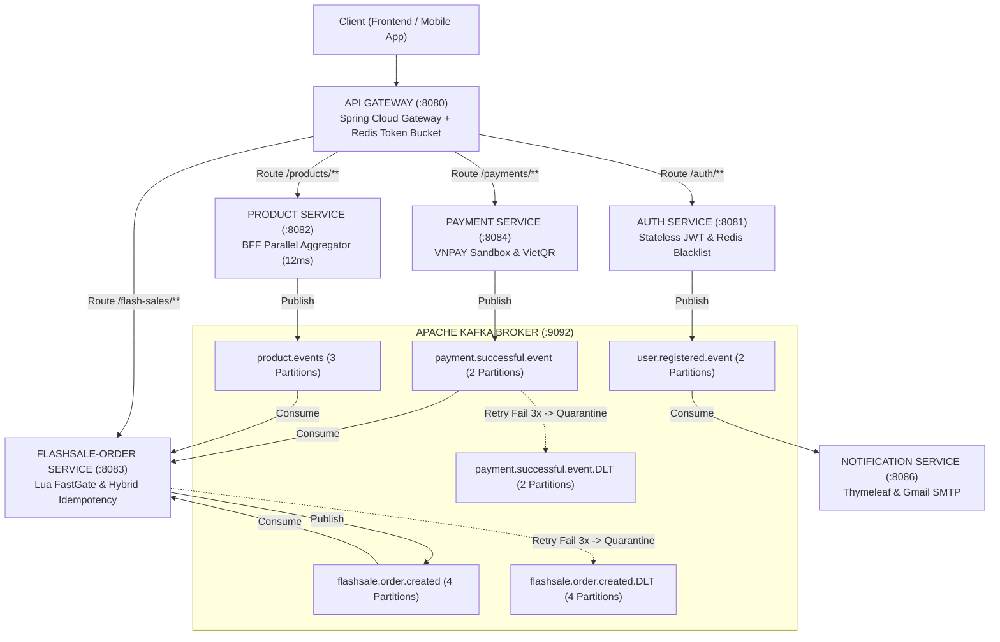

# 🚀 FLASHDEAL API – HỆ THỐNG BACKEND MICROSERVICES & SĂN DEAL PHÂN TÁN

> **High-Concurrency Event-Driven E-Commerce & Flash Sale Backend Engine**  
> *Được xây dựng với: Java 21, Spring Boot 3.4.1, Spring Cloud Gateway, Apache Kafka (KRaft), Redis 7 In-Memory, PostgreSQL 16 và Docker.*

---

## 📑 MỤC LỤC
1. [Tổng Quan Kiến Trúc Backend](#1-tổng-quan-kiến-trúc-backend)
2. [Chi Tiết 6 Microservices & Bảng Phân Chia Cổng](#2-chi-tiết-6-microservices--bảng-phân-chia-cổng)
3. [Bộ 4 Chốt Chặn Chịu Tải & An Toàn Dữ Liệu Doanh Nghiệp](#3-bộ-4-chốt-chặn-chịu-tải--an-toàn-dữ-liệu-doanh-nghiệp)
   - 3.1. [API Gateway Rate Limiting (Redis Token Bucket)](#31-api-gateway-rate-limiting-redis-token-bucket)
   - 3.2. [API Composition Aggregator Đa Luồng (Java Concurrency 12ms)](#32-api-composition-aggregator-đa-luồng-java-concurrency-12ms)
   - 3.3. [Kafka Dead Letter Topic (DLT) & Fault-Tolerance Retry](#33-kafka-dead-letter-topic-dlt--fault-tolerance-retry)
   - 3.4. [Cơ Chế Lũy Đẳng Chuẩn Doanh Nghiệp (Hybrid Idempotency Pattern)](#34-cơ-chế-lũy-đẳng-chuẩn-doanh-nghiệp-hybrid-idempotency-pattern)
4. [Bản Đồ Ứng Dụng Redis & Apache Kafka Topics](#4-bản-đồ-ứng-dụng-redis--apache-kafka-topics)
5. [Cơ Chế Chống Âm Kho & Quản Lý Vòng Đời Đơn Hàng](#5-cơ-chế-chống-âm-kho--quản-lý-vòng-đời-đơn-hàng)
6. [Hướng Dẫn Biên Dịch & Khởi Chạy Hệ Thống](#6-hướng-dẫn-biên-dịch--khởi-chạy-hệ-thống)

---

# 1. TỔNG QUAN KIẾN TRÚC BACKEND

Hệ thống được thiết kế theo mô hình **Event-Driven Architecture (EDA)** kết hợp nguyên tắc **Database-per-Service**:
- **Tải Đọc (Read-Heavy)**: Tối ưu qua **Redis RAM** (Cache danh mục, Tra cứu Autocomplete `< 2ms`, Bảng xếp hạng Hot Search, Rate Limiter).
- **Tải Ghi (Write-Heavy & Concurrency)**: Xử lý bằng **Redis Lua Script nguyên tử** (Cổng chặn tồn kho `< 1.5ms`) và **Apache Kafka** (Phân làn sự kiện theo Partitions), giúp hệ thống phản hồi đặt hàng trong **`< 5ms`** mà không bao giờ bị âm kho hay nghẽn Database.



---

# 2. CHI TIẾT 6 MICROSERVICES & BẢNG PHÂN CHIA CỔNG

| Microservice | Port | Cơ Sở Dữ Liệu | Công Nghệ Chính | Trách Nhiệm Nghiệp Vụ |
| :--- | :---: | :---: | :--- | :--- |
| **`api-gateway`** | `8080` | *Không* | Spring Cloud Gateway, Redis | Điểm vào duy nhất, Routing động, Rate Limiter theo Route (Token Bucket), CORS tập trung, OpenAPI Swagger gom nhóm. |
| **`auth-service`** | `8081` | `auth_db` | Spring Security, JJWT, Redis | Đăng ký, đăng nhập, cấp cặp JWT Token (Access 15p + Refresh 7d), Token Rotation, Logout qua Redis Blacklist. |
| **`product-service`** | `8082` | `product_db` | JPA, Redis ZSET, Multithreading | Quản lý sản phẩm & danh mục. BFF Aggregator đa luồng gom dữ liệu trong **`12ms`**. Tra cứu Autocomplete `< 2ms`. |
| **`flashsale-order-service`** | `8083` | `order_db` | Redis Lua, Spring AOP, Kafka | Chiến dịch Flash Sale, Fast-Gate trừ kho RAM `< 1.5ms`. **Idempotency Hybrid Pattern** chặn click spam `< 1.5ms`. Quản trị đơn hàng & Timeout Restock. |
| **`payment-service`** | `8084` | *Tích hợp Order* | VNPAY SDK, VietQR API, HMAC SHA512 | Cổng VNPAY Sandbox, sinh mã VietQR động, ký số SHA512, phát sự kiện thanh toán thành công vào Kafka. |
| **`notification-service`** | `8086` | *Không* | Spring Kafka, Thymeleaf, JavaMail | Lắng nghe sự kiện từ Kafka để gửi Email xác nhận đăng ký và Email hóa đơn đơn hàng tự động. |

---

# 3. BỘ 4 CHỐT CHẶN CHỊU TẢI & AN TOÀN DỮ LIỆU DOANH NGHIỆP

### 3.1. API Gateway Rate Limiting (Redis Token Bucket)
* Tích hợp bộ lọc phân luồng cấp Route trên Spring Cloud Gateway sử dụng thuật toán **Token Bucket** trong Redis RAM.
* Bảo vệ toàn bộ các microservices phía sau khỏi các đợt tấn công từ chối dịch vụ (DDoS) hoặc bot spam.
* Tự động trả về mã chuẩn **`HTTP 429 Too Many Requests`** khi vượt ngưỡng cho phép.

### 3.2. API Composition Aggregator Đa Luồng (Java Concurrency 12ms)
* Tại endpoint `GET /api/products/{id}/detail-summary` của `product-service`:
  - Gom đồng thời 4 nguồn dữ liệu: Thông tin sản phẩm, Flash Sale Stock, Danh mục cha, và Thống kê tồn kho.
  - Sử dụng `ThreadPoolTaskExecutor` (16 worker threads) kết hợp `CompletableFuture.allOf()`.
  - **Hiệu năng đạt được**: Giảm thời gian phản hồi từ $60ms \rightarrow \mathbf{12ms}$.

### 3.3. Kafka Dead Letter Topic (DLT) & Fault-Tolerance Retry
* Cấu hình chốt chặn lỗi tự động cho Kafka Consumers:
  - `DefaultErrorHandler` kết hợp `FixedBackOff(2000L, 3)`: Thử lại 3 lần (mỗi lần cách 2 giây) khi gặp sự cố tạm thời.
  - Sau 3 lần thất bại, `DeadLetterPublishingRecoverer` tự động bọc thông điệp lỗi kèm header chẩn đoán đẩy vào topic cách ly:
    * `flashsale.order.created.DLT`
    * `payment.successful.event.DLT`
  - `OrderDltConsumer` tiếp nhận, cảnh báo và lưu vết thông điệp lỗi.
  - **Triệt tiêu hoàn toàn**: Mất mát đơn hàng (**Data Loss**) và nghẽn hàng đợi do đơn hỏng (**Poison Pill**).

### 3.4. Cơ Chế Lũy Đẳng Chuẩn Doanh Nghiệp (Hybrid Idempotency Pattern)
* Bảo vệ endpoint Săn Deal `POST /api/flash-sales/orders`:
  1. **Tầng Interceptor (Spring AOP)**: Gắn annotation `@Idempotent(prefix = "flashsale_order", lockTtlSeconds = 30, completedTtlSeconds = 120)`.
  2. **Mô hình Lai (Hybrid Pattern)**:
     - Đọc Header `Idempotency-Key` (UUIDv4) do Frontend truyền lên.
     - Tự động băm `MD5(userId + ":" + campaignId + ":" + productId)` làm phao cứu sinh (Fallback) nếu Client không gửi Header.
  3. **Lệnh nguyên tử Redis `SETNX`**:
     - Request 1: Ghi nhận trạng thái `PROCESSING` với TTL 30s. Sau khi tạo đơn thành công, chuyển sang `COMPLETED` với TTL 120s.
     - Request trùng lặp đến sau: Bị chặn đứng ngay lập tức tại Redis RAM trong **`< 1.5ms`**, trả về **`HTTP 409 Conflict (code: 1090)`**.
     - Nếu nghiệp vụ gặp lỗi (hết hàng, hết giờ): Tự động xóa key (`DEL`) để khách không bị khóa nhầm.

---

# 4. BẢN ĐỒ ỨNG DỤNG REDIS & APACHE KAFKA TOPICS

### 🔹 Khóa Redis RAM:
| Cấu trúc Key | Kiểu Dữ Liệu | Mục Đích | Thời Gian Sống (TTL) |
| :--- | :---: | :--- | :---: |
| `idempotency:flashsale_order:{key}` | `String` | Khóa chống trùng lặp & spam đơn hàng | 30s (`PROCESSING`) / 120s (`COMPLETED`) |
| `flashsale:stock:{campaignId}:{productId}` | `String` | Quản lý tồn kho Flash Sale thời gian thực | Xuyên suốt chiến dịch |
| `flashsale:user:{campaignId}:{productId}:{userId}` | `String` | Chặn mỗi tài khoản chỉ săn 1 lần | 24 giờ |
| `blacklist:token:{token}` | `String` | Vô hiệu hóa Access Token khi Đăng xuất | Bằng thời gian hết hạn còn lại của JWT |
| `refresh:token:{userId}` | `String` | Quản lý vòng xoay Refresh Token | 7 ngày |
| `search:suggestions` | `ZSET` | Gợi ý từ khóa Autocomplete `< 2ms` | Cập nhật khi chỉnh sửa sản phẩm |
| `search:trending` | `ZSET` | Bảng xếp hạng Top từ khóa tìm kiếm hot | Tích lũy thời gian thực |

### 🔹 Apache Kafka Topics:
| Topic | Partitions | Key | Consumer Group | Mục Đích |
| :--- | :---: | :---: | :--- | :--- |
| `flashsale.order.created` | 4 | `productId` | `flashsale-order-group` | Xử lý lưu đơn hàng bất đồng bộ vào PostgreSQL |
| `flashsale.order.created.DLT` | 4 | `productId` | `flashsale-order-dlt-group` | Cách ly đơn hàng lỗi sau 3 lần retry |
| `payment.successful.event` | 2 | `orderCode` | `order-payment-group` | Cập nhật trạng thái đơn hàng sang PAID |
| `payment.successful.event.DLT` | 2 | `orderCode` | `payment-dlt-group` | Cách ly sự kiện thanh toán lỗi |
| `product.events` | 3 | `productId` | `flashsale-product-sync-group` | Đồng bộ trạng thái sản phẩm giữa các service |
| `user.registered.event` | 2 | `userId` | `notification-user-group` | Gửi email chào mừng tài khoản mới |

---

# 5. CƠ CHẾ CHỐNG ÂM KHO & QUẢN LÝ VÒNG ĐỜI ĐƠN HÀNG

### 🛡️ Cổng Chặn Fast-Gate Bằng Redis Lua Script Nguyên Tử:
```
Request Đặt Hàng 
   │
   ▼
[Redis Lua Fast-Gate] ──(Đã mua hoặc Hết hàng)──► HTTP 409 (Out of Stock / Purchased)
   │
   ├─► 1. Check EXISTS user_key == 1 ? return -2 (Đã mua rồi)
   ├─► 2. Check GET stock_key < quantity ? return -1 (Hết hàng)
   ├─► 3. DECRBY stock_key & SET user_key 1 EX 86400 (Trừ kho RAM < 1.5ms)
   │
   ▼
[Kafka Producer] ──► Bắn OrderCreatedEvent vào Partition theo productId (< 5ms)
   │
   ▼
[HTTP Phản Hồi] ──► Trả về HTTP 202 Accepted cho Khách Hàng
   │
   ▼ (Bất đồng bộ)
[PostgreSQL Database] ──► Consumer ghi nhận bản ghi Order & OrderItem
```

### ⏰ Timeout Restock Scheduler:
* Định kỳ mỗi phút, hệ thống tự động quét các đơn hàng ở trạng thái `PENDING` quá **15 phút**.
* Tự động chuyển trạng thái đơn sang `CANCELLED` và **hoàn lại số lượng tồn kho** vào cả Redis RAM lẫn PostgreSQL.

---

# 6. HƯỚNG DẪN BIÊN DỊCH & KHỞI CHẠY HỆ THỐNG

### 1. Đóng gói mã nguồn Java:
```powershell
./mvnw.cmd clean package -DskipTests
```

### 2. Khởi chạy toàn bộ 10 Containers Microservices:
```powershell
docker compose up -d --build
```

### 3. Kiểm tra trạng thái hệ thống:
```powershell
docker compose ps
```

### 4. Truy cập các dịch vụ:
* **API Gateway**: `http://localhost:8080`
* **Kafka UI**: `http://localhost:8085`
* **PostgreSQL Database**: `localhost:5434`
* **Redis Server**: `localhost:6380`
